<div align="center">


# Dave’s Palace

**Le casino royal de Jean-Pascal Zadi, en orbite.**
Mise des DaveCoins, ouvre des caisses, collectionne toute la bande en cartes néon et vise le jackpot.

[](https://kyniops.github.io/Dave-s-Palace/)


<br>

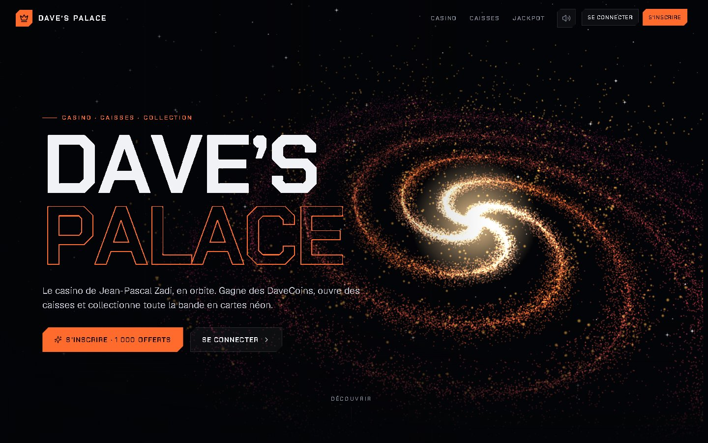

<sub>Jeu fictif : aucun argent réel, les DaveCoins n’ont aucune valeur.</sub>

</div>

---

## Sommaire

- [En bref](#en-bref)
- [Les jeux](#les-jeux)
- [Caisses et collection](#caisses-et-collection)
- [Progression](#progression)
- [Social et en ligne](#social-et-en-ligne)
- [Présentation et sur mobile](#présentation-et-sur-mobile)
- [Lancer le projet](#lancer-le-projet)
- [Structure du code](#structure-du-code)
- [Ajouter un jeu](#ajouter-un-jeu)

## En bref

| | |
|---|---|
| **13 jeux** | machine à sous, roulette, blackjack, poker entre joueurs, crash, plinko, mines… |
| **Collection** | 7 caisses, 52 cartes de la bande, 6 raretés, cartes brillantes, albums |
| **Progression** | 100 niveaux, 7 rangs avec rakeback, missions du jour, 62 succès |
| **En ligne** | comptes sur tous les appareils, jackpot partagé en direct, classement, amis, duels, échanges |
| **Anti-triche** | en ligne, le serveur tire chaque résultat et tient le solde : le navigateur ne fait qu’afficher |
| **Sans installation** | ouvre `index.html` et c’est parti (mode local), ou joue en ligne sur GitHub Pages |

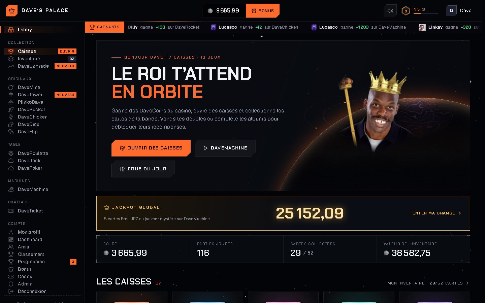

## Les jeux

| Jeu | Principe | RTP |
|---|---|---|
| 🎰 **DaveMachine** | Machine à sous 5×3, 20 lignes, visages de la bande, wild JPZ, 3 cartes Free JPZ = 15 free spins ×2 en hyperespace, **jackpot global progressif**, tirage auto | 96,5 % |
| 🎟️ **DaveTicket** | Ticket à gratter (Bronze, Argent, Or, Royal) : trouve 3 photos identiques, jusqu’à ×1000 | 95 % |
| 💣 **DaveMine** | Grille 5×5, trouve les DaveCoins, évite les bombes (1 à 24) | 99 % |
| 🗼 **DaveTower** | 10 étages, une porte par étage, 4 difficultés, encaissement à tout moment | 98 % |
| 🔻 **PlinkoDave** | 8, 12 ou 16 lignes, 3 niveaux de risque, jusqu’à ×1000 | 99 % |
| 🚀 **DaveRocket** | Crash : encaisse avant que JPZ ne s’écrase, dès ×1,01, auto-encaissement | 99 % |
| 🐔 **DaveChicken** | Traverse la route voie après voie, 4 difficultés | 99 % |
| 🎲 **DaveDice** | Jetons sur les membres de la bande, 3 dés en 3D : ×2, ×3 ou ×12 par case | 95,8 % |
| 🪙 **DaveFlip** | DaveCoin ou JPZ, enchaîne les victoires ×1,98 | 99 % |
| 🎡 **DaveRoulette** | Roulette européenne en canvas (bille physique, déflecteurs), jetons animés | 97,3 % |
| 🃏 **DaveJack** | Blackjack 6 jeux : doubler, séparer, blackjack payé 3:2 | 99,4 % |
| ♠️ **DavePoker** | Texas Hold’em No Limit **entre joueurs** : tables publiques ou privées, 4 niveaux de blindes, pas de bots | 100 % |
| 📈 **DaveUpgrade** | Sacrifie des cartes (et des DaveCoins) pour viser une carte plus chère, aiguille sur une jauge | 95 % |

<table>
  <tr>
    <td width="50%">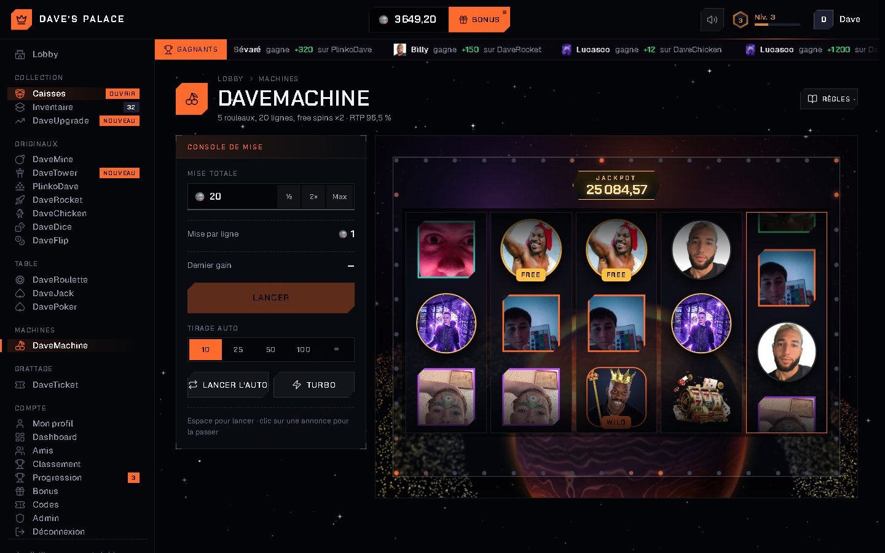<br><b>DaveMachine</b> · jackpot global progressif</td>
    <td width="50%">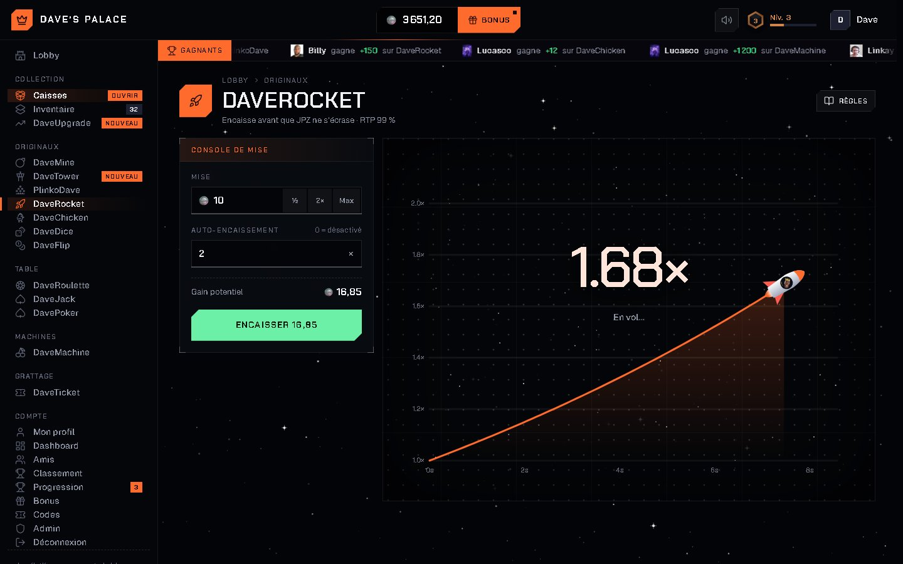<br><b>DaveRocket</b> · la fusée en plein vol</td>
  </tr>
  <tr>
    <td>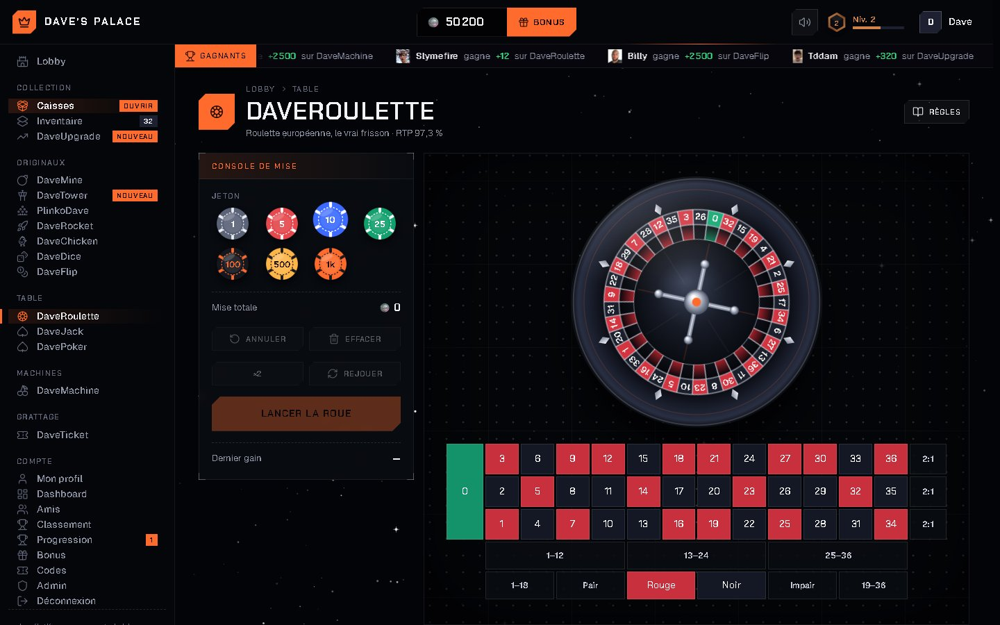<br><b>DaveRoulette</b> · roulette européenne en canvas</td>
    <td>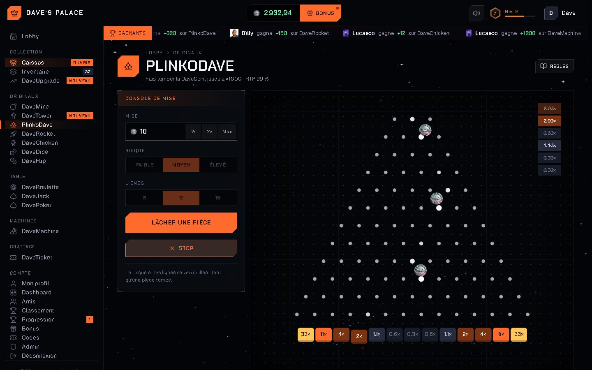<br><b>PlinkoDave</b> · jusqu’à ×1000</td>
  </tr>
  <tr>
    <td>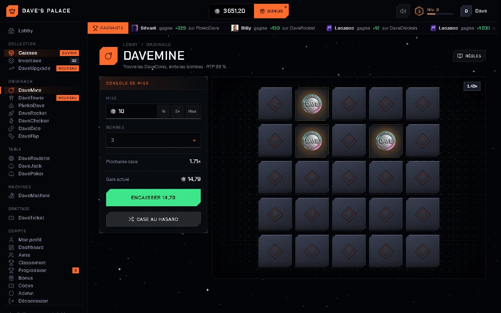<br><b>DaveMine</b> · trouve les DaveCoins</td>
    <td>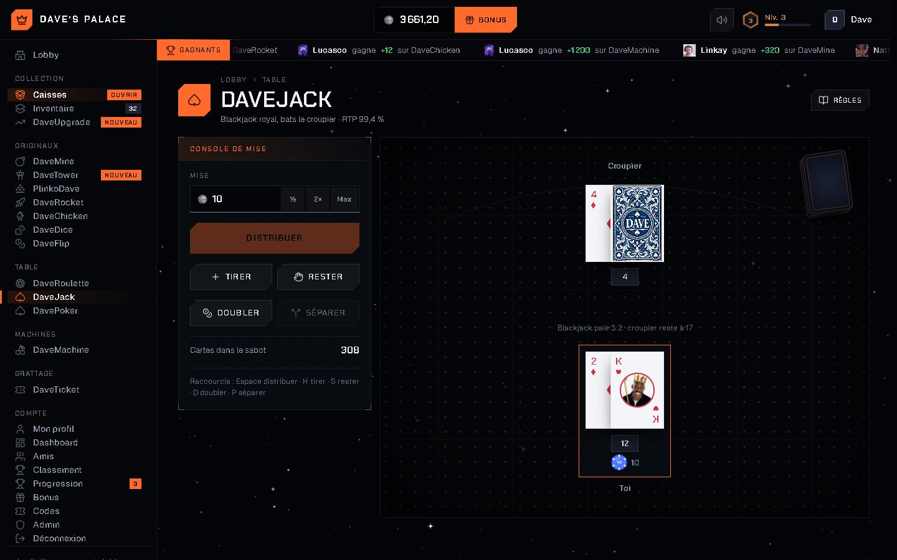<br><b>DaveJack</b> · blackjack 6 jeux</td>
  </tr>
  <tr>
    <td>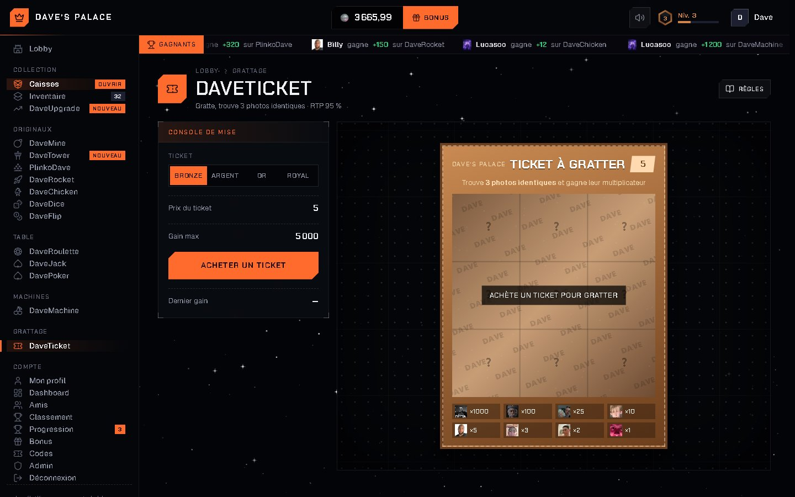<br><b>DaveTicket</b> · gratte 3 photos identiques</td>
    <td>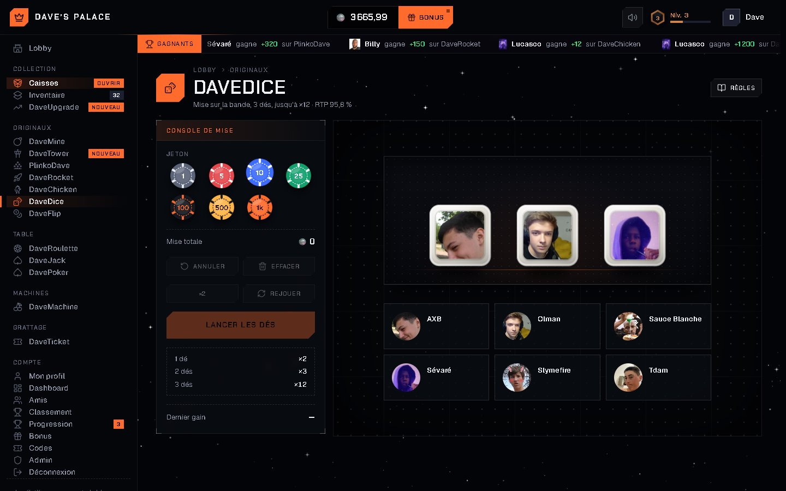<br><b>DaveDice</b> · mise sur la bande</td>
  </tr>
  <tr>
    <td>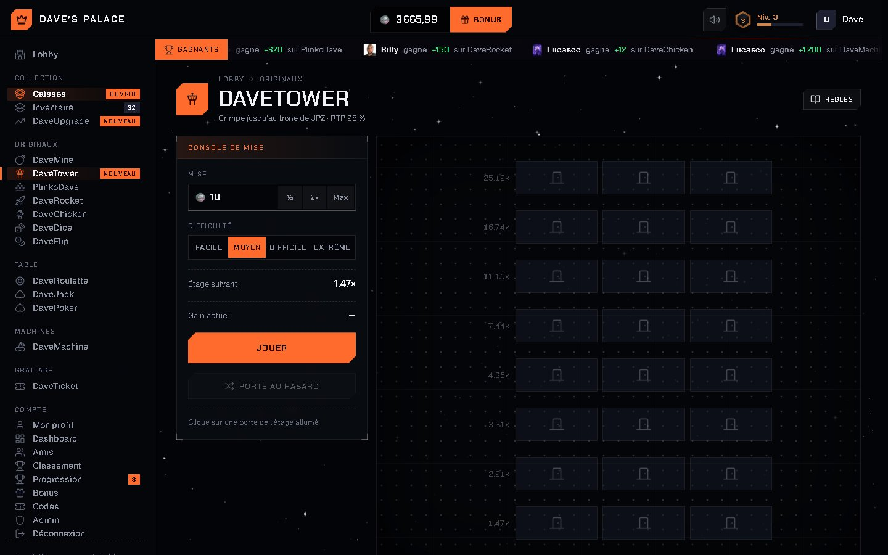<br><b>DaveTower</b> · grimpe jusqu’au trône</td>
    <td>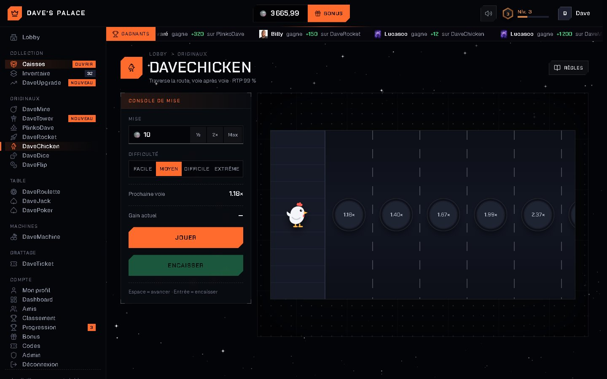<br><b>DaveChicken</b> · traverse la route</td>
  </tr>
</table>

## Caisses et collection

La boucle principale : gagne des DaveCoins, ouvre des caisses, récupère les cartes de la bande. Vends-les ou garde-les pour compléter les albums.

- **7 caisses à thème** : Bande (10), Gamers (25), Kawaï (50), Selfie (75), Aura (100), Wanted (250), Royale JPZ (500)
- **52 cartes**, 6 raretés : Commun, Peu commun, Rare, Épique, Légendaire, Mythique. Les chances exactes sont affichées
- **Ouverture ×1 à ×4**, mode **Battle** contre la bande ou **duel** contre un ami
- **Albums** : une caisse complète = 10× son prix, une seule fois
- **Fusion** : 5 cartes identiques deviennent une carte **brillante** (valeur ×5, cadre arc-en-ciel)
- **DaveUpgrade** : chance = 95 % × mise ÷ valeur visée (80 % maximum)

<table>
  <tr>
    <td width="50%">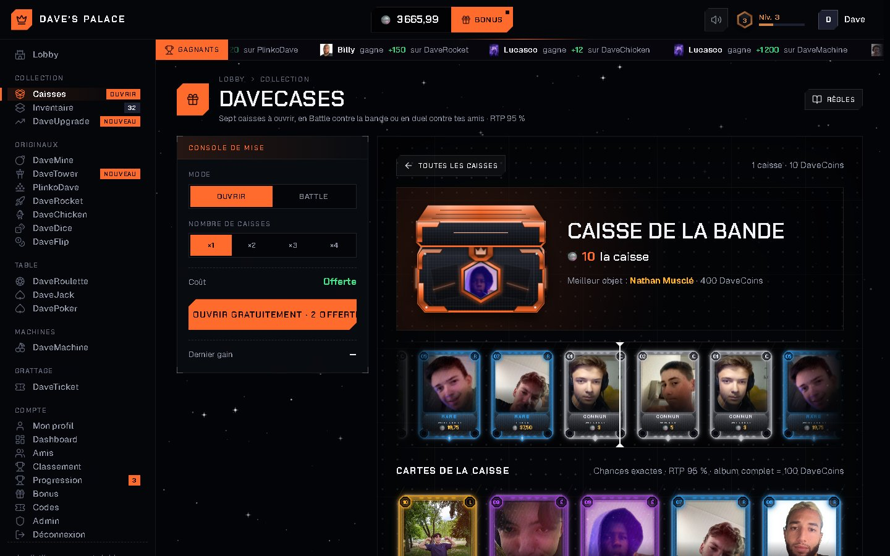<br><b>DaveCases</b> · ouverture d’une caisse</td>
    <td width="50%">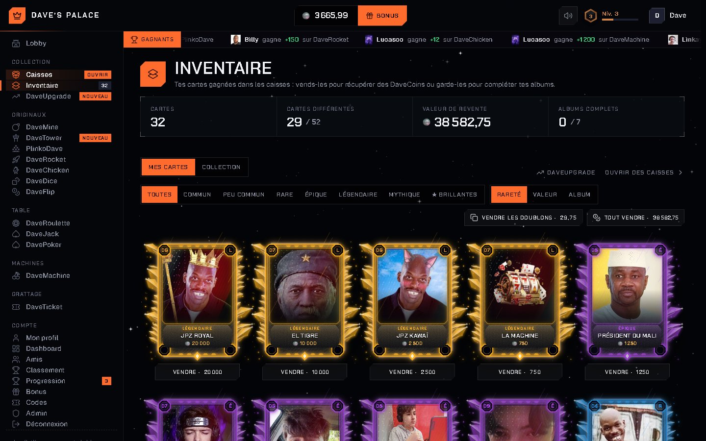<br><b>Inventaire</b> · cartes néon par rareté</td>
  </tr>
  <tr>
    <td colspan="2">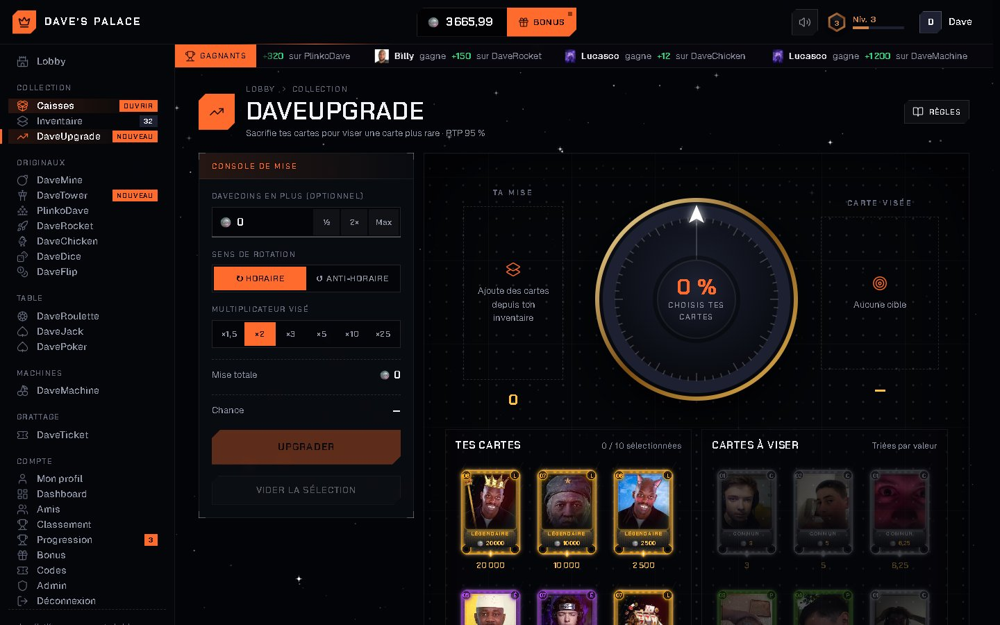<br><b>DaveUpgrade</b> · sacrifie des cartes pour viser plus haut</td>
  </tr>
</table>

## Progression

- **Niveaux 1 à 100** : l’XP suit le risque réellement pris en misant. Récompenses à chaque niveau, caisse offerte tous les 5 niveaux
- **7 rangs** : Bronze, Argent, Or, Platine, Diamant, Maître, JPZ, avec un **rakeback** de 10 % à 40 % à réclamer
- **3 missions par jour** (facile, moyenne, difficile) et **62 succès**
- **Bonus** : roue quotidienne toutes les 12 h (100 à 5 000 DaveCoins), dépannage quand ton solde est à sec, codes promo
- **Jackpot global** : 1 % de chaque mise l’alimente. Il tombe sur DaveMachine avec 5 cartes Free JPZ, ou par déclenchement mystère
- **Dashboard joueur** : solde, bilan, taux de victoire, RTP perso, courbe du solde, détail par jeu, historique
- **Profil** : photo, bannière, titre, bio et vitrine de 3 cartes

<table>
  <tr>
    <td width="50%">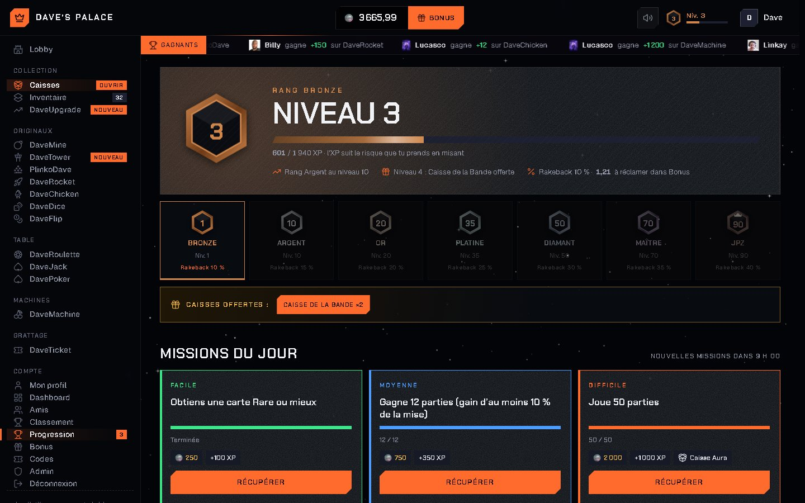<br><b>Progression</b> · rangs, rakeback, missions</td>
    <td width="50%">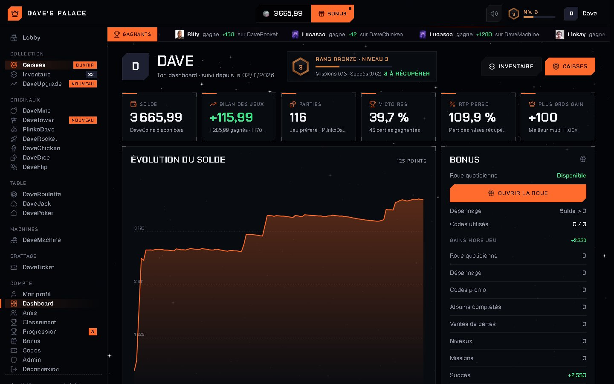<br><b>Dashboard</b> · courbe du solde et bilan</td>
  </tr>
</table>

## Social et en ligne

La version en ligne tourne sur **Supabase** :

- comptes utilisables sur tous les appareils, sauvegarde automatique dans le cloud
- jackpot partagé en direct, fil des gros gains, page **Classement**
- **amis** et notifications en direct
- **duels de caisses** entre amis et **échanges de cartes**, avec des protections contre les multi-comptes
- **DavePoker** : tables entre joueurs, tout est décidé par le serveur (paquet, enchères, pots annexes)
- dashboard **admin** : comptes, économie par jeu (RTP réel et théorique), bannissement

**Anti-triche** : le serveur tient le solde, l’inventaire, les stats et la progression, et tire lui-même le résultat de chaque partie ([`supabase/engine.sql`](supabase/engine.sql)). Impossible de modifier son solde ou ses cartes depuis le navigateur.

## Présentation et sur mobile

Avant la connexion, une page de présentation animée : galaxie 3D (three.js) qui plonge au scroll, sections révélées en motion design.
Tout le site est responsive.

<table>
  <tr>
    <td width="36%" rowspan="2" align="center">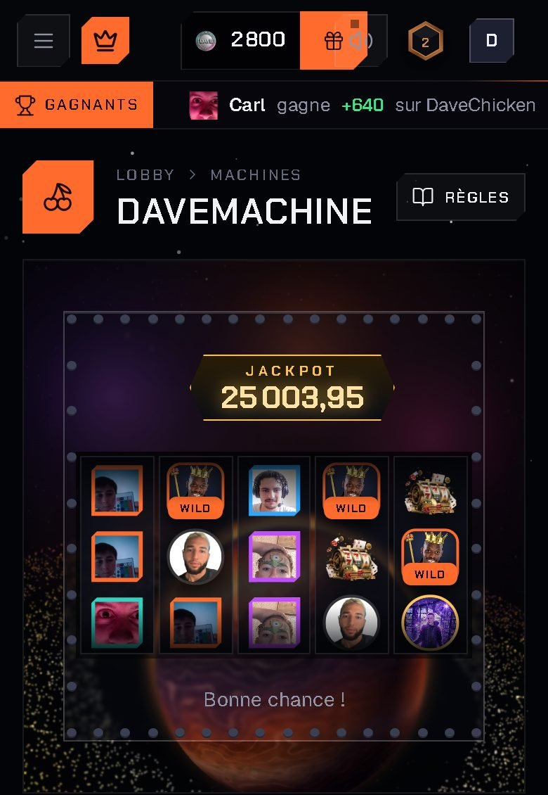<br><b>Sur mobile</b></td>
    <td>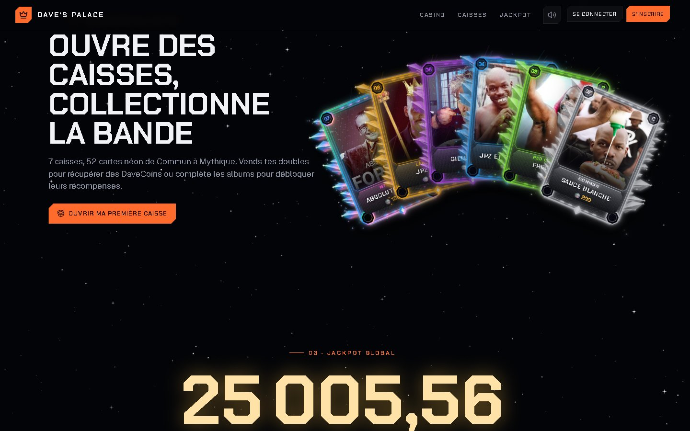</td>
  </tr>
  <tr>
    <td>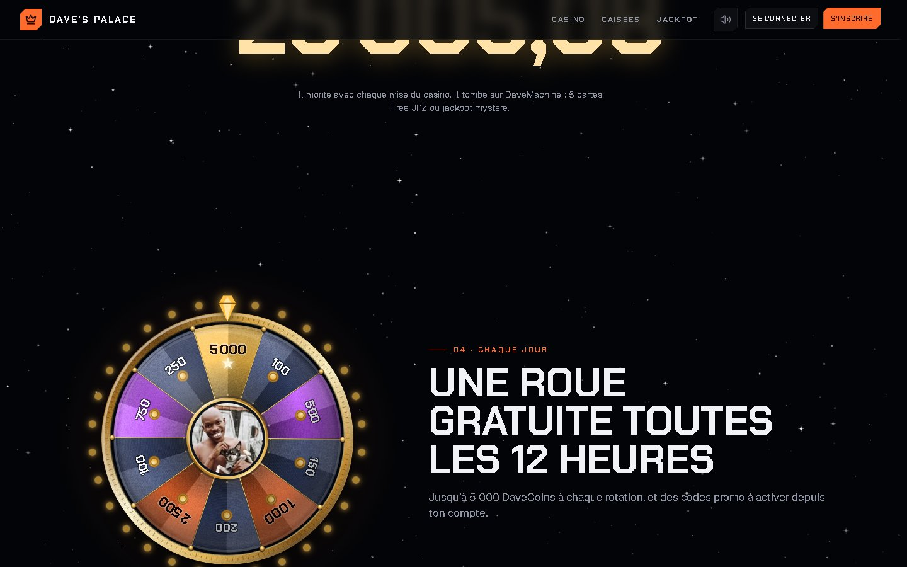</td>
  </tr>
</table>

**Ambiance** : musique acoustique en boucle, et la version phonk prend le relais pendant les gros moments (gain ×10 et plus, free spins, jackpot, carte légendaire…). Le sound design est synthétisé en Web Audio, avec des particules, des secousses et une pluie de DaveCoins. Musique et effets se règlent séparément.

## Lancer le projet

**Jouer en ligne** : [kyniops.github.io/Dave-s-Palace](https://kyniops.github.io/Dave-s-Palace/)

**En local** : aucun serveur, aucune installation. Ouvre `index.html` dans ton navigateur. En `file://` (ou hors ligne), le site passe en **mode local** : comptes du navigateur, 1 000 DaveCoins offerts au départ.

**Avec ta propre base Supabase** : crée un projet, puis colle les fichiers de [`supabase/`](supabase) dans *SQL Editor > New query > Run*, dans cet ordre :

1. `schema.sql`, puis `engine.sql` (moteur de jeu)
2. `social.sql`, `poker.sql`
3. `duels.sql`, `trades.sql`, `admin.sql`, `security.sql`, `email.sql`
4. les extensions et réglages : `scratch.sql`, `selfie.sql`, `horsserie.sql`, `reorg.sql`, `rakeback.sql`, `rescue.sql`, `limits.sql`, `codes.sql`, `xp_fix.sql`, `fix_inscription.sql`, `eco.sql`, `streak.sql`, `market.sql`, `xss.sql`, `hardening.sql`, `guilds.sql`, `antitriche.sql`, `admin_lock.sql`, `machine2.sql`, `fortune.sql`, `namefx.sql`, `frames.sql` (puis `select public.admin_set_code('…');` pour choisir le code admin), `admin_lock.sql` (puis `select public.admin_set_code('…');` pour choisir le code admin)

La plupart des fichiers peuvent être relancés sans risque. Les réglages (mise maximum, niveaux minimum, dépannage…) se changent ensuite dans *Table Editor > eng_const*.

## Structure du code

```
index.html            point d’entrée unique (navigation par #/...)
assets/img/           photos de la bande, DaveCoin, dos de carte…
assets/audio, sfx/    musiques d’ambiance et effets sonores
css/main.css          design system, lobby, navigation
css/games.css         mise en page et styles de chaque jeu
css/intro.css         page de présentation
js/core.js            portefeuille, comptes, inventaire, sons, composants UI
js/progress.js        niveaux, rangs, missions, succès, caisses offertes
js/engine.js          liaison avec le moteur de jeu du serveur (anti-triche)
js/cloud.js           version en ligne (Supabase : comptes, sauvegarde, jackpot, classement)
js/social.js          amis et notifications
js/profile.js         profil (photo, bannière, titres, vitrine)
js/dashboard.js       dashboards joueur et admin
js/app.js             routeur, lobby, inventaire
js/intro.js           page de présentation (galaxie three.js, transitions)
js/games/*.js         un fichier par jeu (slot-engine.js = maths de DaveMachine, testables sous Node)
supabase/*.sql        base de données, moteur de jeu et extensions
docs/screenshots/     captures du README
```

## Ajouter un jeu

Crée `js/games/monjeu.js` et enregistre-le :

```js
DP.games.register({
  id: 'monjeu', name: 'DaveMonJeu', icon: 'dice-5', hue: 20,
  tagline: 'Une phrase d’accroche', rtp: '97 %', rules: '…',
  mount(root) {
    // DP.wallet.place(mise) pour débiter, DP.settle(id, mise, gain) pour régler la partie
    return () => { /* nettoyage */ };
  }
});
```

Ajoute ensuite la balise `<script>` dans `index.html`. Pour la version en ligne, le tirage doit se faire côté serveur : ajoute une fonction dans `supabase/engine.sql` sur le modèle de `dice_roll` ou `plinko_drop`.

---

<div align="center">
<sub>Icônes <a href="https://icons8.com">Icons8</a> (pack Windows 11 Regular) · crédits des effets sonores dans <a href="assets/sfx/CREDITS.txt">assets/sfx/CREDITS.txt</a></sub>
</div>
